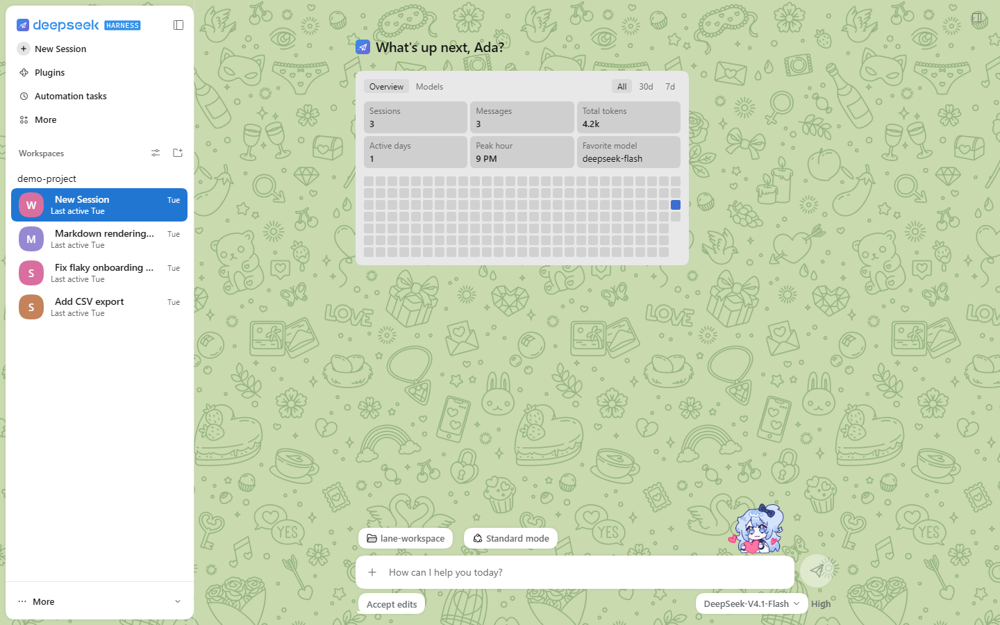
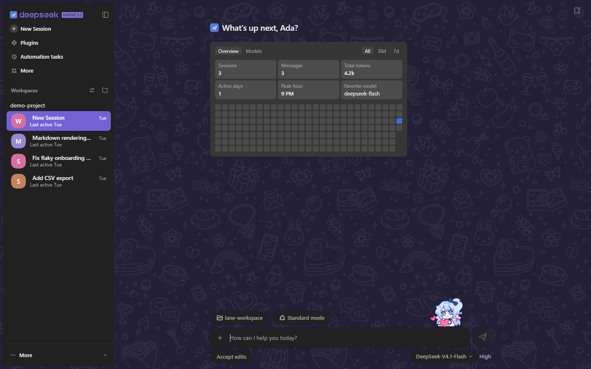
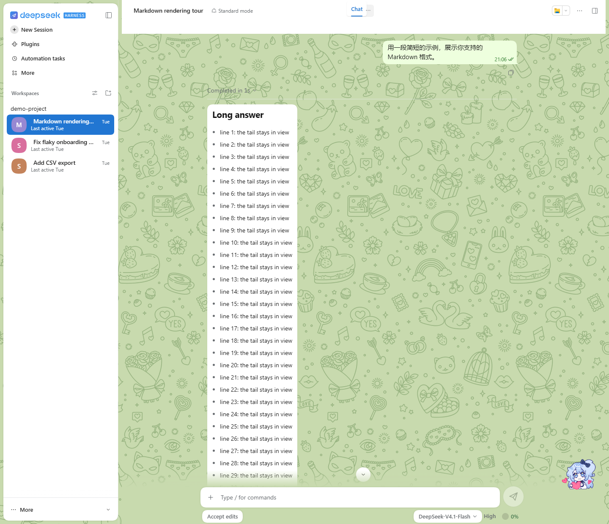
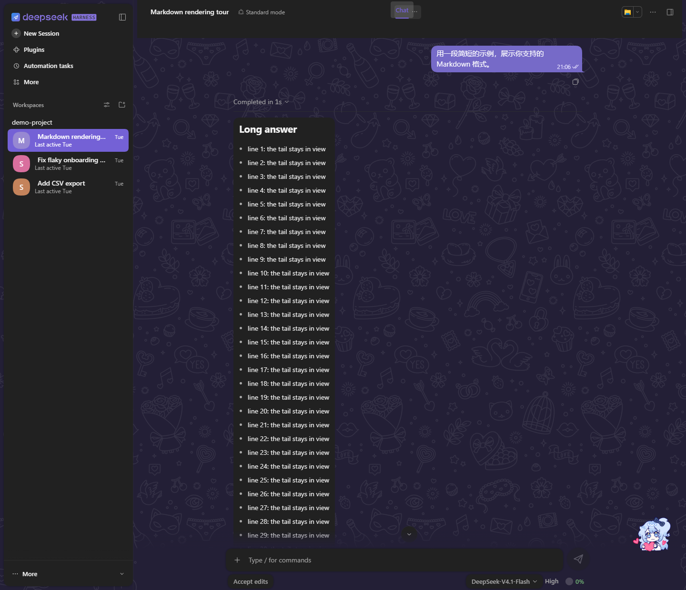

# dsh-telegram-style

A Telegram Web style theme for DeepSeek Harness: a floating chat list on a wallpaper, session rows, message bubbles, a floating input bar and three palettes.

> Unofficial work, not affiliated with Telegram, DeepSeek or Anthropic. Modified from [dsh-claude-style](https://github.com/Nwflower/dsh-claude-style) (MIT, © 2026 Nwflower).

<table>
  <tr>
    <td align="center" width="50%"></td>
    <td align="center" width="50%"></td>
  </tr>
  <tr>
    <td align="center" width="50%"></td>
    <td align="center" width="50%"></td>
  </tr>
</table>

## What it does

- **Wallpaper**: a plain colour with a pattern laid over it, the pattern tinted per palette. The Appearance page of the plugin settings can turn the pattern off and keep only the colour.
- **Floating cards**: the chat list, the right panel, the header and the input bar float on the wallpaper; on a narrow window the cards go edge to edge.
- **Session rows**: a coloured initial avatar, the time, a second line of status, and badges.
- **Conversation**: a solid header; bubbles with Telegram's shape and small tail, sent messages carry a time and a status tick; Markdown, code and tables follow the bubble's look.
- **Input bar**: a floating rounded bar with 48px send and stop buttons, a pill-shaped tool row, an accent-coloured caret, and a send animation that flies the bubble from the bar into the conversation.
- **Details**: line-art icons, Telegram-style menus and toasts, thin scrollbars and a click ripple.
- **Sticker mascot**: a sticker stands on the input bar's top edge and acts out the chat's state (thinking, working, waiting for your approval, an error, done, asleep); a click lets hearts float up and a double click makes it hop. The Appearance page of the plugin settings can turn it off, or keep it to the home page.

## Palettes

- Classic: Telegram's default green wallpaper, white cards in light, a violet tone in dark.
- Glass: a blue-violet wallpaper with translucent frosted cards.
- Pink: a light pink wallpaper with deeper pink patterns; bubbles and buttons are in blues.

Every palette has a light and a dark side that follow DeepSeek Harness's own light/dark switch. Pick one with the segmented control on the Appearance page of the plugin settings.

## Install

The easiest way is one click on the Themes tab of the dsh-market plugin market. From the command line, install it from npm (package `dsh-telegram-style`):

WebUI:

    dsh plugin --profile web add dsh-telegram-style

Desktop: use the dsh that ships with the desktop app, at `%LOCALAPPDATA%\Programs\DeepSeek Harness\resources\runtime\cli\bin\dsh.cmd`:

    "%LOCALAPPDATA%\Programs\DeepSeek Harness\resources\runtime\cli\bin\dsh.cmd" plugin --profile desktop add dsh-telegram-style

Replace the package name with `github:xmlans/dsh-telegram-style` to install from the GitHub repository; it carries the built `lib/`, so nothing needs building.

Then enable "Telegram Style" in DeepSeek Harness's skin centre. It can be installed next to dsh-claude-style; one is enabled at a time.

## Known limitations

- The language label at the top left of a code block is not restyled and stays as the host draws it: the host's code block header has no stable hook.
- Workspace rows keep the upstream's compact style and may look out of step between the taller session rows.
- Compared with upstream, the session row's "ongoing" indicator and the sidebar density (relaxed / compact) preferences are removed; the running state shows on the row's second line instead.
- The Glass palette uses `backdrop-filter`, so scrolling can slow down in a very long session; switch to Classic or Pink if it does.
- With dsh-chat-ux installed, this theme's matching chat features (folding, token reveal, send animation, follow and caret) stand down for it.

## License

- Code: MIT, see [LICENSE](LICENSE).
- JetBrains Mono ships under the SIL OFL 1.1.
- The wallpaper pattern is supplied by the project's maintainer, who may redistribute it; see [THIRD_PARTY_NOTICES.md](THIRD_PARTY_NOTICES.md).
- The sticker mascot's artwork is the author's, all rights reserved, and not covered by the MIT license; see [LICENSE](LICENSE).
- Third-party sources are listed in [THIRD_PARTY_NOTICES.md](THIRD_PARTY_NOTICES.md).
