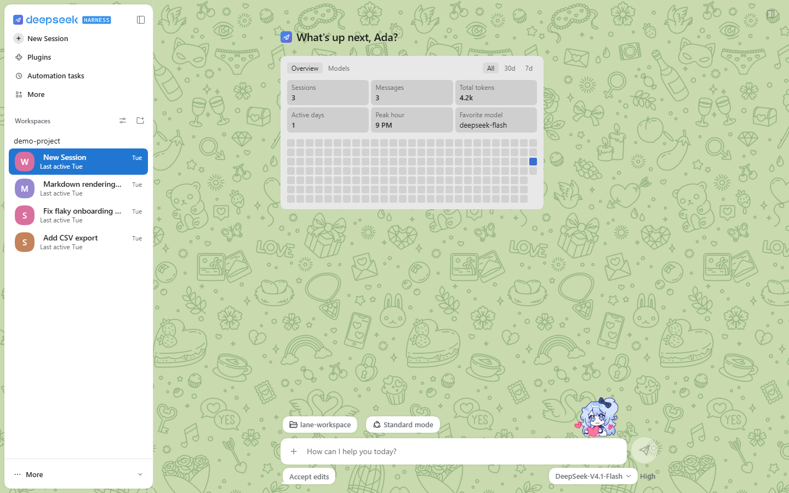
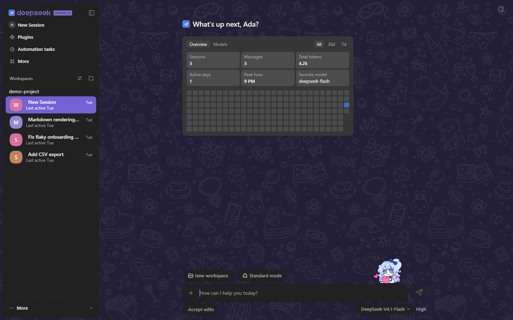
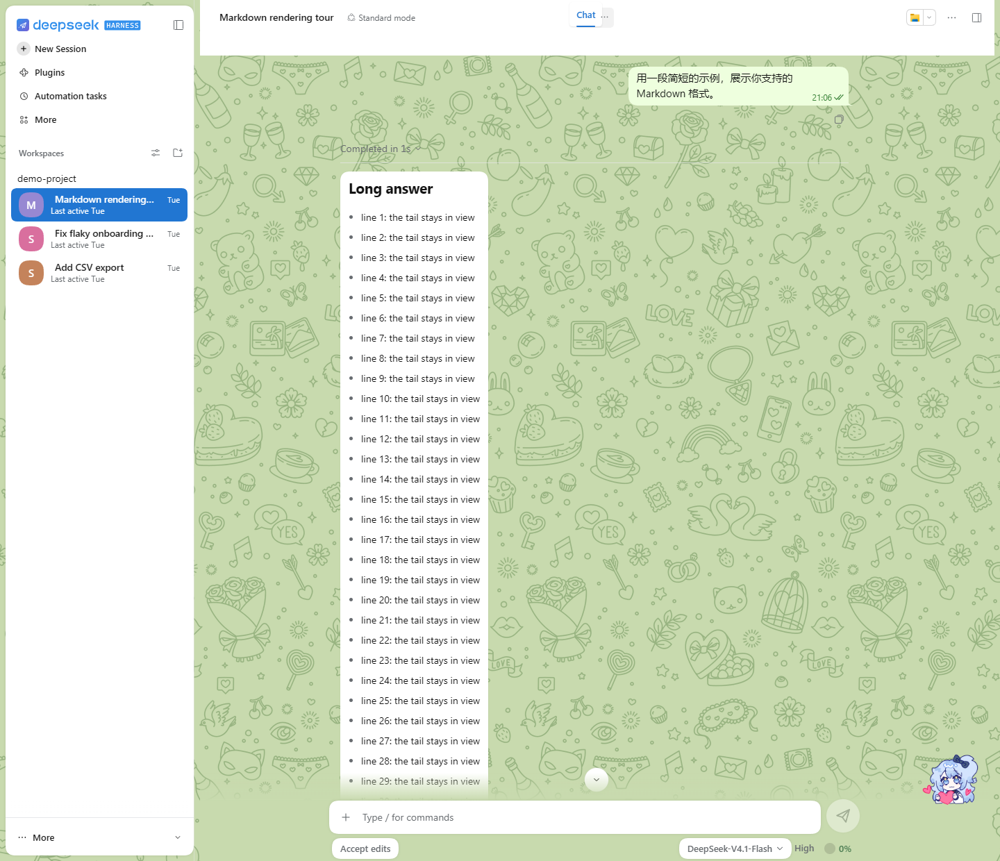
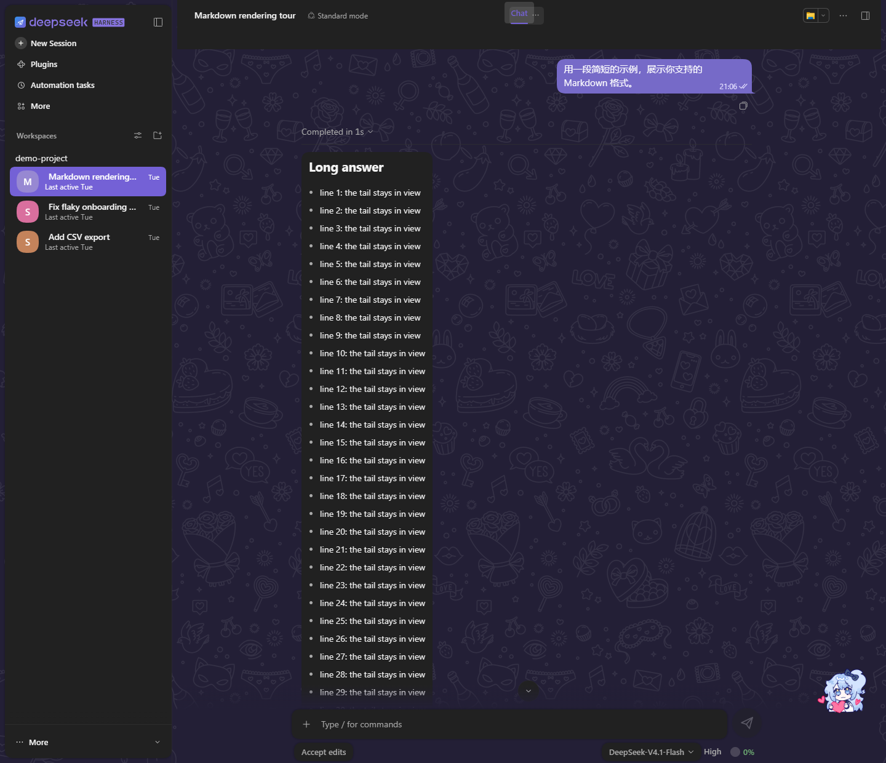

# dsh-telegram-style

DeepSeek Harness 的 Telegram 网页版风格主题：墙纸上的浮动聊天列表、会话行、消息气泡、悬浮输入条和三套配色。

> 非官方作品，与 Telegram、DeepSeek、Anthropic 均无关联。本项目基于 [dsh-claude-style](https://github.com/Nwflower/dsh-claude-style)（MIT，© 2026 Nwflower）修改。

<table>
  <tr>
    <td align="center" width="50%"></td>
    <td align="center" width="50%"></td>
  </tr>
  <tr>
    <td align="center" width="50%"></td>
    <td align="center" width="50%"></td>
  </tr>
</table>

## 有什么

- **墙纸**：纯色底，上面铺一层图案，图案按配色染色。在插件设置的"外观"页可以关掉图案，只留纯色。
- **浮动卡片**：聊天列表、右侧面板、标题栏、输入条都是浮在墙纸上的卡片；窄屏下卡片贴边铺满。
- **会话行**：彩色首字母头像、时间、第二行状态、角标。
- **对话**：实色标题栏；气泡有 Telegram 的外形和小尾巴，发出的消息带时间和状态勾；Markdown、代码、表格的样式跟着气泡走。
- **输入条**：悬浮的圆角输入条，48px 的发送键和停止键，工具行是胶囊，光标取强调色，发送时气泡从输入条飞到对话里。
- **细节**：线稿图标、Telegram 式的菜单和 Toast、细滚动条、点击波纹。
- **贴纸桌宠**：一张贴纸站在输入条上沿，跟着会话的状态做动作（思考、干活、等你批准、出错、完成、睡着）；单击冒爱心，双击跳一下。在插件设置的"外观"页可以关掉，也可以只让它出现在首页。

## 配色

- 经典：Telegram 默认的绿色墙纸，亮色白卡片，暗色紫调。
- 玻璃：蓝紫墙纸，半透明磨砂卡片。
- 粉色：浅粉墙纸配深粉图案，气泡和按钮是蓝色系。

三套配色都有亮色和暗色，跟随 DeepSeek Harness 自己的亮暗切换。在插件设置的"外观"页用分段控件挑选。

## 安装

WebUI：

    dsh plugin --profile web add <dsh-telegram-style-0.1.0.tgz 的路径>

桌面版：用桌面版自带的 dsh，路径在 `%LOCALAPPDATA%\Programs\DeepSeek Harness\resources\runtime\cli\bin\dsh.cmd`：

    "%LOCALAPPDATA%\Programs\DeepSeek Harness\resources\runtime\cli\bin\dsh.cmd" plugin --profile desktop add <tgz 路径>

装好后在 DeepSeek Harness 的皮肤中心启用"Telegram Style"。和 dsh-claude-style 可以同时安装，同一时刻启用一个。

## 已知限制

- 代码块左上角的语言标签没有改样式，保持宿主原样：宿主的代码块标题栏没有稳定的挂点。
- 工作区行仍是上游的紧凑样式，夹在较高的会话行之间可能不太协调。
- 与上游相比，会话行的"进行中"指示和侧栏疏密（宽松 / 紧凑）两项偏好已经删除，运行状态改由会话行第二行显示。
- 玻璃配色用了 `backdrop-filter`，特别长的会话里滚动可能变慢；觉得卡可以换成经典或粉色。
- 装了 dsh-chat-ux 时，本主题对应的聊天功能（折叠、逐字显示、发送动画、跟随、光标）会让位给它。

## 许可

- 代码：MIT，见 [LICENSE](LICENSE)。
- JetBrains Mono：按 SIL OFL 1.1 随包分发。
- 墙纸图案由项目维护者提供，可再分发，见 [THIRD_PARTY_NOTICES.md](THIRD_PARTY_NOTICES.md)。
- 贴纸桌宠的图版权归作者，不适用 MIT，见 [LICENSE](LICENSE)。
- 第三方来源见 [THIRD_PARTY_NOTICES.md](THIRD_PARTY_NOTICES.md)。
